<h1 align="center">
  Contract Clause Reviewer
</h1>

<p align="center">
  An AI-powered contract analysis service with a FastAPI backend, a React + TypeScript frontend, and an Appsmith dashboard — built around layered architecture, async processing, and production-shaped engineering.
</p>

<p align="center">
  
  
  
  
  
  
  
  
  
  
  
  
  
</p>

<p align="center">
  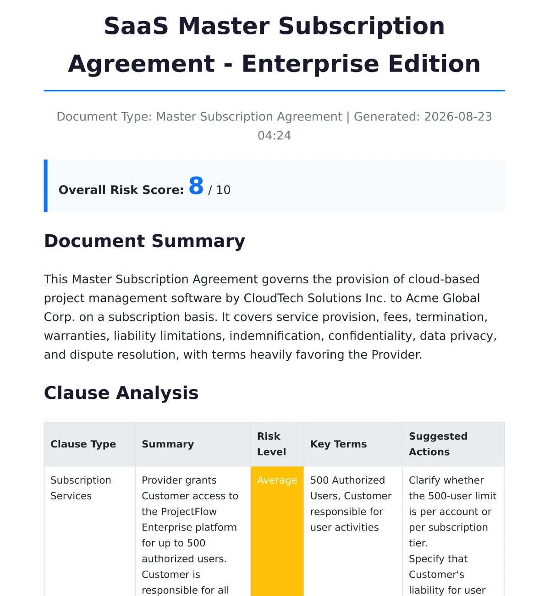
</p>

<table>
<tr>
<td align="center">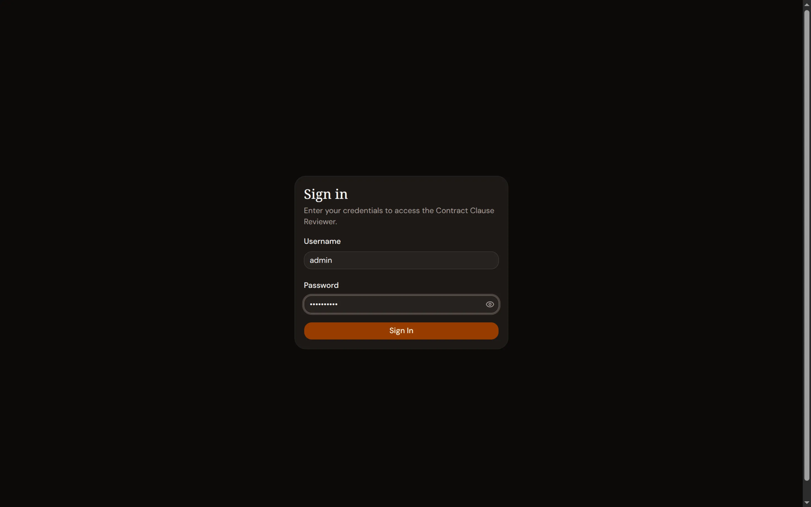</td>
<td align="center">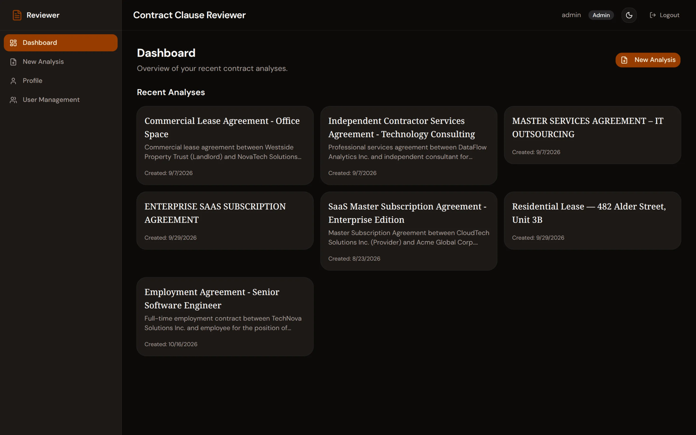</td>
</tr>
<tr>
<td align="center">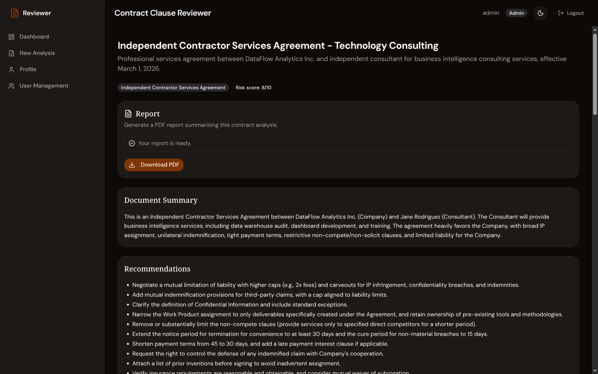</td>
<td align="center">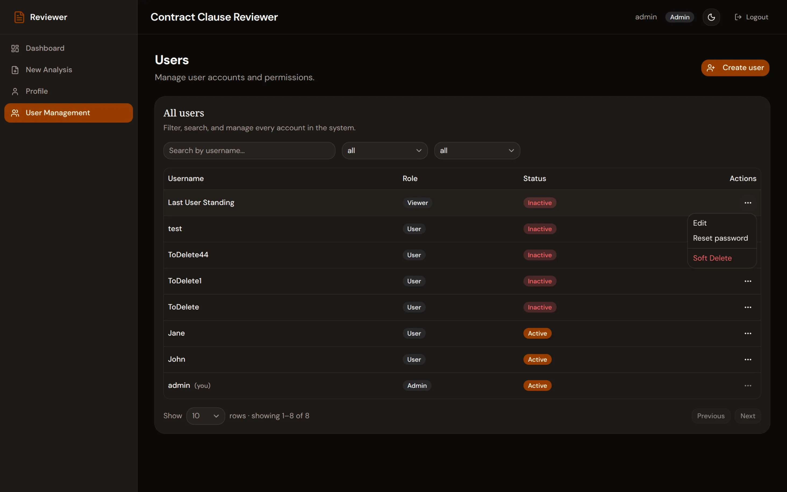</td>
</tr>
</table>

<table>
<tr>
<td align="center">
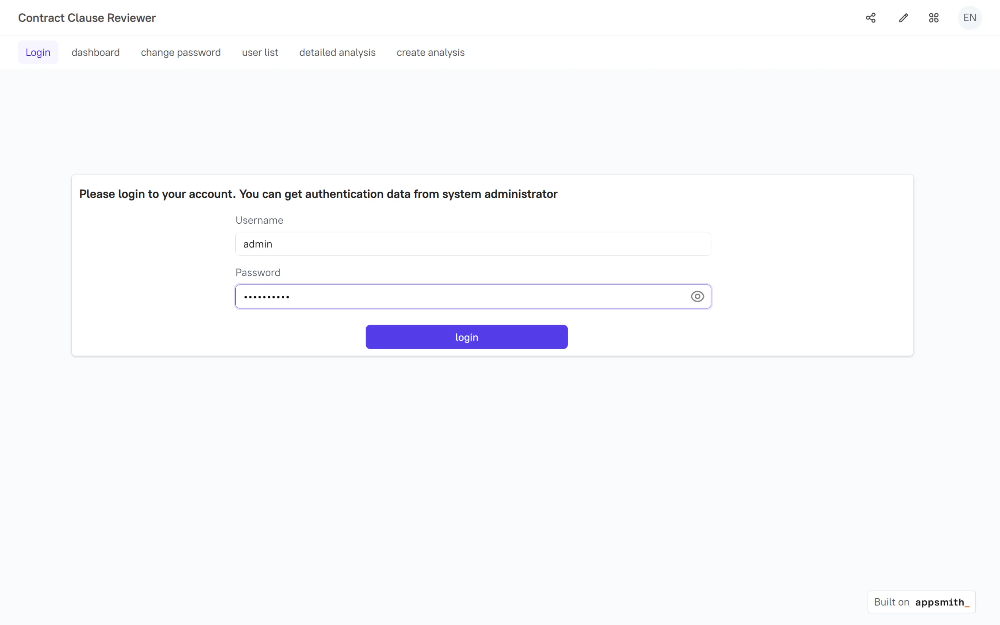
</td>

<td align="center">
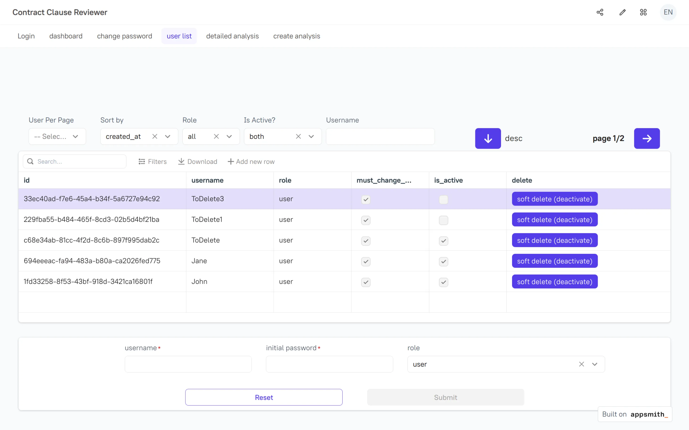
</td>
</tr>

<tr>
<td align="center">
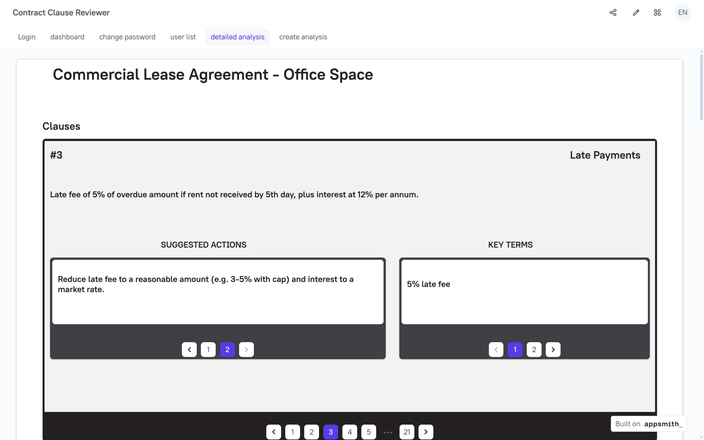
</td>

<td align="center">
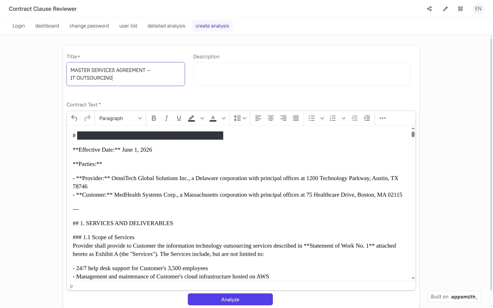
</td>
</tr>

</table>

---

# Contract Clause Reviewer

Contract Clause Reviewer is a portfolio project exploring how an AI-powered backend can be structured as a production-oriented service rather than a single FastAPI application — and how a **hand-written API-driven React frontend** can replace low-code dashboards without requiring a single backend change.

The application accepts contract text, sends the document to an LLM for structured analysis, stores the resulting clauses and risk information, and can generate a downloadable PDF report. The React frontend is a first-class client of the same OpenAPI contract that powers the Appsmith dashboard.

The project focuses primarily on the engineering behind the product:

**Backend:**

- Layered architecture with explicit separation of responsibilities
- Dependency injection through FastAPI dependencies
- Asynchronous HTTP, database and Redis I/O at the API boundary
- Celery-based background processing for LLM analysis and PDF generation
- PostgreSQL persistence with SQLModel and Alembic
- Local JWT authentication with access/refresh token workflow
- Refresh-token rotation and server-side token persistence
- Role-based access control for administrative endpoints
- Redis-backed global and endpoint-specific rate limiting
- Queue-based application logging with dedicated audit logging
- Dockerized API and worker deployment
- Unit and integration test separation

**Frontend:**

- React 19 + TypeScript + Vite with feature-oriented architecture
- Centralized API client wrapping `fetch`, with reactive token refresh
- TanStack Query for server state (queries, mutations, polling)
- React Hook Form + Zod for form state and runtime validation
- shadcn/ui + Tailwind CSS v4 with light/dark/system theming
- Auth lifecycle with session restoration, protected routes, and role-based UI gating
- Vitest + React Testing Library for infrastructure and behavioral tests

This is primarily an architecture and engineering portfolio project. It is not intended to replace professional legal review.

---

# Features

## Contract Analysis

Users can submit contract text for asynchronous analysis.

The analysis service:

- identifies key contract clauses
- classifies clause types
- assigns clause-level risk levels
- calculates an overall document risk score
- produces a document summary
- highlights key terms
- provides suggested actions and recommendations

LLM output is validated against a Pydantic schema before it is persisted. The analyzer also enforces a maximum document length and truncates long documents at a paragraph boundary where possible.

## Background Processing

LLM analysis and PDF generation are deliberately kept out of the request/response path.

The API queues Celery tasks and immediately returns a task identifier. Workers perform the expensive operations and persist the results.

Celery is configured with:

- dedicated analysis and cleanup queues
- task retry policies
- exponential retry backoff with jitter
- late acknowledgements
- task time limits
- worker concurrency control
- periodic cleanup tasks

The frontend polls the status endpoints (`/analysis/status/{task_id}` and `/reports/status/{task_id}`) via TanStack Query's `refetchInterval`, which stops automatically on terminal states.

## Authentication and RBAC

Authentication uses a local JWT workflow.

Access tokens are short-lived JWTs containing a subject, token type, expiry and JTI. Refresh tokens are opaque random values and only their SHA-256 hashes are persisted in the database.

The authentication layer supports:

- access-token validation
- refresh-token validation
- refresh-token rotation
- token revocation
- session metadata such as IP address and user-agent
- active-user checks
- admin-only dependencies

See [`docs/authentication.md`](docs/authentication.md) for the complete workflow, and [`docs/frontend.md`](docs/frontend.md) for how the React client consumes it.

## Rate Limiting

Redis is used for rate limiting at multiple levels.

The project includes:

- global per-IP protection
- login-specific limits
- public endpoint limits
- authenticated-user limits
- stricter analysis limits
- admin endpoint limits
- reusable custom rate-limit dependencies

Rate-limit information is exposed through standard response headers such as `X-RateLimit-Limit`, `X-RateLimit-Remaining`, `X-RateLimit-Reset` and `Retry-After`.

## Logging and Auditing

The application uses a queue-based logging pipeline so application code does not synchronously perform file I/O for every log record.

The logging infrastructure uses:

- `QueueHandler`
- `QueueListener`
- rotating application logs
- separate error and warning logs
- access logging
- a dedicated audit log
- custom `AuditLogger` helpers
- graceful queue flushing during shutdown

User and administrator actions are represented as structured key/value log messages so operational events are easier to search and inspect.

## PDF Report Generation

Completed analyses can be converted into PDF reports.

The report pipeline is:

```text
Analysis in PostgreSQL
        |
        v
Celery report task
        |
        v
HTML report generation
        |
        v
WeasyPrint
        |
        v
PDF file in reports storage
        |
        v
Analysis record updated with report metadata
```

An example report is included at [`docs/example_report.pdf`](docs/example_report.pdf).

## React Frontend

The `frontend/` directory contains a full single-page application that consumes the same API as the Appsmith dashboard.

Highlights:

- **Feature-oriented architecture** — vertical slices under `src/features/` that mirror backend API tags (`auth`, `users`, `analysis`, `reports`).
- **Centralized API client** — a single `fetch` wrapper handles base URL, JSON serialization, error normalization (FastAPI 422 array vs. string `detail`), and reactive token refresh with a single-flight refresh queue.
- **Reactive authentication** — the app restores the session on mount, refreshes the access token on 401, and logs out on refresh failure. Tokens are held in `localStorage` with wrapper helpers.
- **Polling as a first-class pattern** — TanStack Query's `refetchInterval` drives the analysis and report status pages. Polling stops on terminal states and caps at 3 consecutive failures.
- **Consistent form stack** — React Hook Form + Zod + shadcn `Field` primitives across all forms, with shared error mapping via `handleFormError`.
- **Route protection** — `RequireAuth`, `RequireRole`, and `GuestRoute` guards. UI gating is treated as UX, not security; the backend remains the security boundary.
- **Design system** — shadcn/ui primitives, Tailwind v4 CSS variables, light/dark/system themes, responsive layout shell.

See [`docs/frontend.md`](docs/frontend.md) for the architecture, and [`frontend/README.md`](frontend/README.md) for local development.

## Appsmith Dashboard

The `appsmith/` directory contains a JSON export of an Appsmith dashboard that demonstrates the same backend can serve multiple presentation layers:

```text
                    +-------------------+
                    |   FastAPI API     |
                    |     /api/v1       |
                    +-------------------+
                       /           \
                      /             \
                     v               v
             React Frontend       Appsmith
                                  Dashboard
```

The Appsmith dashboard was the original UI for this project. It is retained as a demonstration of API reuse and as a point of comparison with the React frontend. See [**Two Frontends: React vs. Appsmith**](#two-frontends-react-vs-appsmith) below for the tradeoffs observed.

---

# Screenshots

<p align="center">
  
</p>

<p align="center">
  Example generated report showing document summary, overall risk and clause-level findings.
</p>

## Database Structure

<p align="center">
  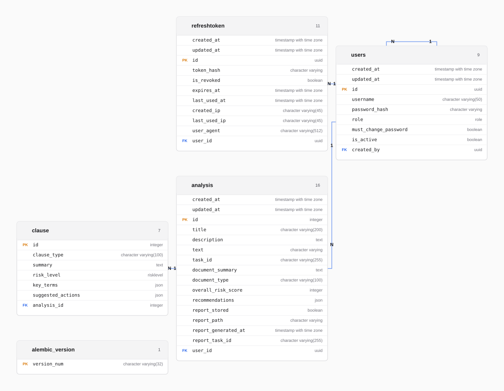
</p>

---

# Architecture

The application follows a layered backend architecture with a feature-oriented React frontend. Infrastructure concerns are kept separate from business-oriented services on both sides.

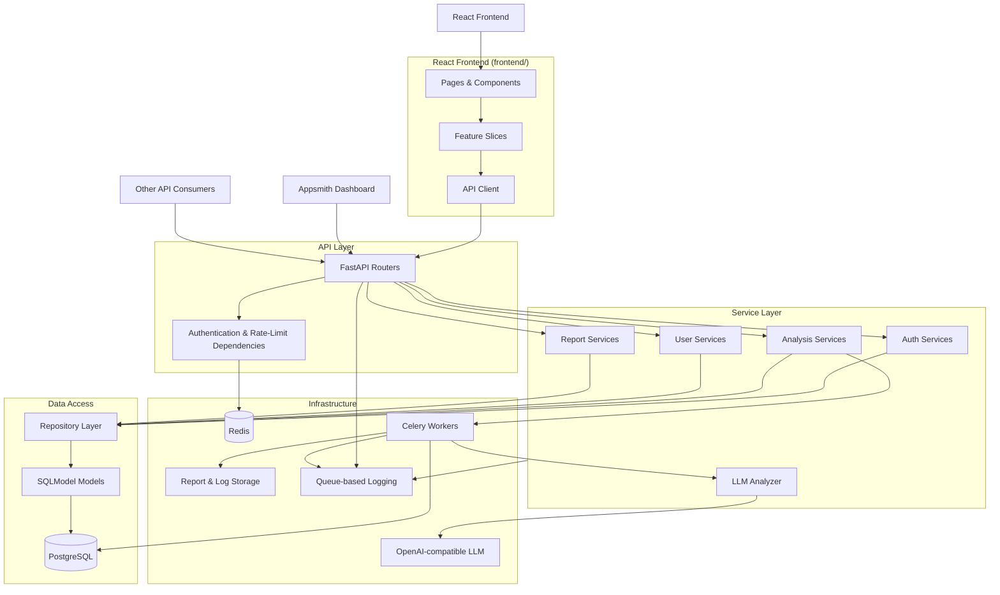

The main application boundaries:

**Backend:**

```text
API           → routing, request/response concerns, auth & rate-limit deps
Services      → business workflows, orchestration
Repositories  → database access capabilities
Models/Schemas → persistence + validation models
Core          → config, security, Celery, enums, exceptions
Infrastructure → Redis, OpenAI, storage, logging
Tasks         → analysis, reports, cleanup
```

**Frontend:**

```text
app/          → root composition (providers)
pages/        → route-level components (thin composition)
features/     → vertical slices (auth, users, analysis, reports)
components/   → reusable UI (ui primitives, layout, common patterns)
lib/          → technical infrastructure (API client, auth storage, tokens)
hooks/        → generic reusable hooks
types/        → pure TypeScript contracts mirroring backend Pydantic schemas
```

More detail is available in [`docs/architecture.md`](docs/architecture.md) and [`docs/frontend.md`](docs/frontend.md).

---

# Backend

The backend is built with:

<ul>
<li><b>FastAPI:</b> API framework and dependency injection</li>
<li><b>SQLModel:</b> database models and SQLAlchemy integration</li>
<li><b>PostgreSQL:</b> primary relational database</li>
<li><b>Alembic:</b> database migrations</li>
<li><b>Celery:</b> distributed background task processing</li>
<li><b>Redis:</b> Celery broker/result backend and rate-limit storage</li>
<li><b>Pydantic:</b> request, response and LLM output validation</li>
<li><b>Granian:</b> ASGI application server</li>
<li><b>WeasyPrint:</b> HTML-to-PDF report generation</li>
<li><b>OpenAI-compatible API:</b> LLM integration</li>
</ul>

The Python project requires Python 3.14+ and uses `uv` for dependency management.

---

# Frontend

The frontend lives in `frontend/` and is built with:

<ul>
<li><b>React 19:</b> UI library</li>
<li><b>TypeScript:</b> type safety for API contracts, forms, and props</li>
<li><b>Vite 8:</b> dev server and production build tool</li>
<li><b>React Router:</b> client-side routing with nested layouts and protected routes</li>
<li><b>TanStack Query:</b> server state — queries, mutations, polling, cache invalidation</li>
<li><b>React Hook Form + Zod:</b> form state and runtime schema validation</li>
<li><b>shadcn/ui + Tailwind CSS v4:</b> design system, layout, and theming</li>
<li><b>Lucide:</b> icon set</li>
<li><b>Vitest + React Testing Library:</b> unit and integration tests</li>
</ul>

The frontend is a **pure API consumer** — it requires no backend changes, no server-side rendering, and no framework-specific integration. It talks to the FastAPI backend through the documented OpenAPI surface.

Key architectural decisions:

- **Server state vs. client state separation.** TanStack Query owns everything that comes from the backend. Local `useState` owns UI concerns (dialog open/closed, filter state). React Hook Form owns form field values. Auth state is held in React Context because it's a session-level concern, not per-query data.
- **One API client, no exceptions.** Feature files never call `fetch` directly, except for the PDF download endpoint (binary response, no JSON parsing).
- **Reactive token refresh.** A single-flight queue prevents concurrent 401s from triggering parallel refreshes that would invalidate rotated refresh tokens.
- **Polling stops at terminal states.** The polling hooks return `false` from `refetchInterval` once a task reaches `completed` or `failed` — every poll after that is wasted network cost.
- **URL is the identity.** Route components read params, validate them, and hand off to keyed stateful views. Changing `/analysis/1` → `/analysis/2` produces a fresh component instance, not a state reset.

Full architecture: [`docs/frontend.md`](docs/frontend.md).

---

# Async I/O and Work Offloading

The HTTP application uses asynchronous database and Redis clients and asynchronous OpenAI calls.

The important design distinction is that the worker boundary is intentionally synchronous:

```text
HTTP request
     |
     | async
     v
FastAPI
     |
     | queue task
     v
Celery
     |
     | worker process
     v
CPU / blocking / long-running work
     |
     +--> LLM analysis
     +--> database persistence
     +--> PDF generation
```

This means the API remains responsive while long-running analysis and report-generation work is handled by worker processes.

Celery tasks are synchronous functions by design. The document analysis task bridges to the asynchronous LLM service inside the worker process, while database persistence and PDF generation are performed synchronously within the task.

On the frontend side, this pattern is mirrored: the React client never blocks on long-running work. It fires a request, receives a `task_id`, and polls a status endpoint until a terminal state.

---

# Database

PostgreSQL stores:

- users
- refresh-token records
- analyses
- analyzed clauses
- report metadata

SQLModel models live in `app/models/`, while database access is organized through repository functions in `app/repositories/`.

The application has both:

- an async database URL for the API
- a sync database URL for Celery workers

Alembic is used for schema migrations.

---

# Authentication Flow

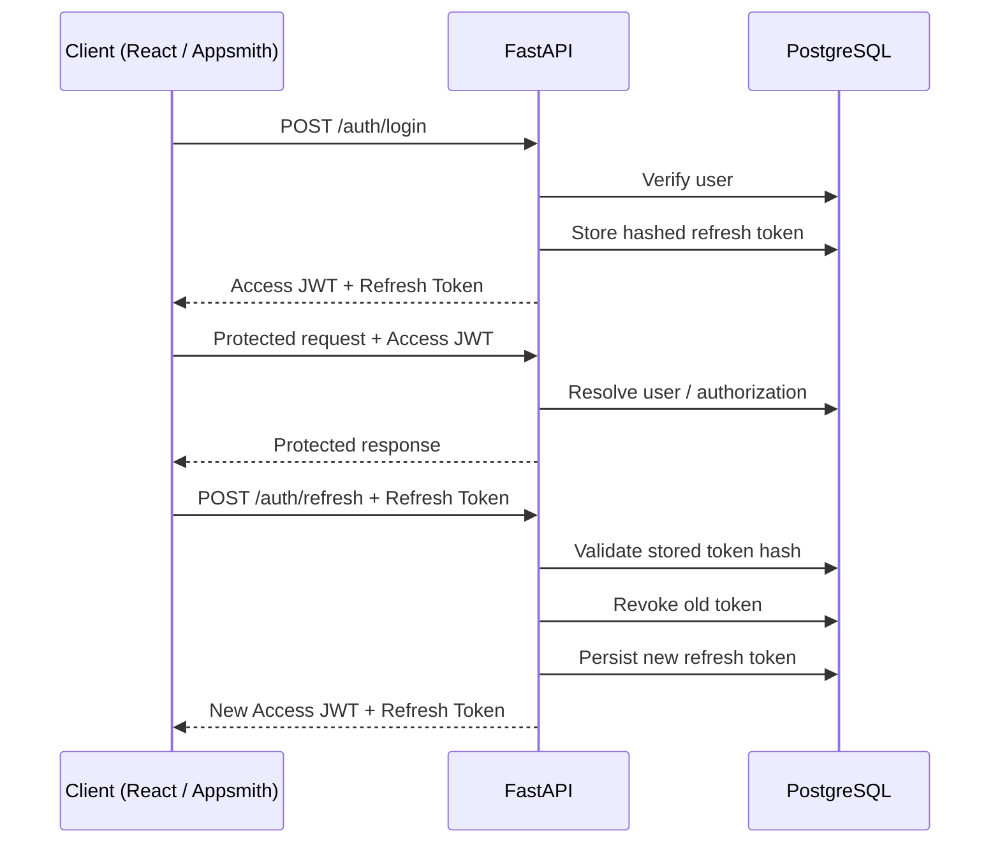

Access tokens are short-lived JWTs. Refresh tokens are opaque values whose hashes are stored server-side. This avoids putting refresh-token secrets directly into the database and makes server-side revocation possible.

The React client implements this flow end-to-end: tokens are stored in `localStorage`, the API client attaches the access token to every request, and a 401 triggers a single-flight refresh that retries the original request with the new token. If the refresh fails, the client clears tokens and redirects to `/login`.

---

# Security

The project includes several security-oriented controls:

- password hashing with Argon2 through `pwdlib`
- short-lived JWT access tokens
- opaque refresh tokens
- refresh-token rotation
- refresh-token revocation
- server-side refresh-token persistence
- JTI values on access tokens
- active-user checks
- admin-only dependencies
- Redis-backed rate limiting
- audit logging for sensitive actions
- environment-based secrets and database configuration

The frontend contributes:

- reactive token refresh with a single-flight queue (prevents token invalidation from concurrent refreshes)
- route guards as UX (backend remains the security boundary)
- role-based UI gating (`RequireRole`)
- clearing the query cache on logout so the next session cannot see the previous user's data

This portfolio project should still be treated as a learning system rather than as a security-certified legal product. Production deployment would require additional controls such as secrets management, HTTPS termination, hardened cookie/CORS policy where applicable, security headers, monitoring and a formal threat model.

---

# Two Frontends: React vs. Appsmith

Both frontends consume the same API. The comparison below reflects what was learned by building both.

|                                   | Appsmith Dashboard                                         | React Frontend                                                                     |
| --------------------------------- | ---------------------------------------------------------- | ---------------------------------------------------------------------------------- |
| **Initial setup**                 | Very fast — import JSON, configure datasource              | Higher — tooling, project structure, decisions                                     |
| **Custom auth workflows**         | Requires coded workarounds; susceptible to race conditions | Explicit, controllable, testable                                                   |
| **Responsive design**             | Weak — layouts resist adaptation                           | Native — Tailwind + shadcn handle breakpoints                                      |
| **Reusability across projects**   | Low — dashboards stay bound to their app                   | High — auth, API client, form stack port between projects                          |
| **Iteration speed once underway** | Slows as complexity grows                                  | Faster as patterns stabilize                                                       |
| **AI-assisted development**       | Limited — AI cannot meaningfully edit Appsmith dashboards  | High — OpenAPI specs + typed React code give AI agents a rich surface to work with |
| **Backend changes required**      | Occasionally (for auth flows)                              | **None** — the OpenAPI contract is sufficient                                      |

**Observations:**

- The React path has a **higher initial learning curve**, but combining it with FastAPI's OpenAPI spec makes subsequent development exceptionally smooth. The frontend can be designed without touching the backend.
- **Custom authentication** (refresh rotation, single-flight refresh queues, role-based route guards) has no direct Appsmith solution. Any coded workaround is fragile and prone to race conditions — precisely the class of bug React + TanStack Query solves structurally.
- **Responsive design** is a significant gap in Appsmith. The React frontend is naturally responsive because the layout shell owns the viewport, pages own their content grids, and shadcn primitives are layout-neutral.
- **Modularity** matters over a career, not just a project. The React frontend's auth provider, API client, and form handling are portable to future projects with minimal changes. An Appsmith dashboard is not.
- **AI-assisted iteration** is arguably the most important long-term consideration. Low-code tools advertise "rapid integration," but AI agents cannot meaningfully modify Appsmith dashboards. They can read OpenAPI specs, generate typed React code, and validate it against tests. The same trend that makes low-code attractive may make it obsolete for AI-driven workflows.
- Compared to **SSR solutions** (Jinja + FastAPI, Django templates), the API-driven React frontend keeps frontend and backend concerns cleanly separated. No backend rendering work, no template coupling, no shared `urls.py` / `views.py` lifecycle. The OpenAPI contract is the only coupling — and AI agents can operate against that contract productively.

The React frontend is the recommended default. Appsmith remains useful for quick internal dashboards over an existing API, particularly when no custom auth or responsive layout is required.

---

# Deployment

Docker is used to run the production-shaped backend as separate services.

The Compose setup contains:

```text
PostgreSQL
    |
    +------------------+
    |                  |
    v                  v
 FastAPI API       Celery worker
    |                  |
    +--------+---------+
             |
           Redis
```

The Dockerfile provides separate build targets for:

- `api`
- `celery-worker`

The runtime image includes:

- Python 3.14
- a non-root `appuser`
- cached `uv` dependency installation
- WeasyPrint system dependencies
- application health checks for the API

Docker Compose also provides persistent volumes for PostgreSQL, Redis, reports and logs.

## Frontend Production Build

The frontend builds to static assets and is served by any HTTP server (Nginx, Caddy, a CDN). It does not require Node.js at runtime.

```bash
cd frontend
pnpm install
pnpm build
# Output: frontend/dist/
```

The `dist/` directory contains the compiled `index.html`, hashed JS/CSS bundles, and static assets. It can be served alongside the FastAPI backend from the same origin via a reverse proxy, or from a separate host with CORS configured on the backend.

For development, the frontend uses Vite's dev server (`pnpm dev`) with a proxy that forwards `/api/*` to the backend, avoiding CORS entirely.

---

# How To Run

## Requirements

Make sure the following tools are installed:

- Python 3.14+
- uv
- Docker
- Docker Compose
- **Node.js 20+ and pnpm** (for the frontend)

An OpenAI-compatible API endpoint is also required for actual document analysis.

## Backend Setup

Clone the repository:

```bash
git clone https://github.com/enoorii/contract-clause-reviewer.git
cd contract-clause-reviewer
```

Install Python dependencies:

```bash
uv sync
```

Create the environment file:

```bash
cp .env.example .env
```

Set the required LLM configuration and review the database, Redis, authentication and application settings in `.env`.

Start the development services:

```bash
docker compose up -d --build
```

This will run alembic migrations using the existing migration file in the repo.

The API is exposed on `http://localhost:9000`. OpenAPI documentation is available at `http://localhost:9000/docs`.

## Frontend Setup

In a separate terminal:

```bash
cd frontend
cp .env.example .env
pnpm install
pnpm dev
```

The frontend is exposed on `http://localhost:5173`. It proxies `/api/*` to `http://localhost:9000` via Vite's dev server, so no CORS configuration is required for local development.

For the full frontend setup, environment variables, build commands, and testing, see [`frontend/README.md`](frontend/README.md).

## Generate Alembic Migrations And Applying Them

To do this you should run the database using `docker-compose.test.yaml` and then run alembic.

```text
docker compose -f docker-compose.test.yaml --env-file .env.test up -d
ENV_FILE=.env.test uv run alembic revision --autogenerate -m "message"
ENV_FILE=.env.test uv run alembic upgrade head
```

---

# Running Celery Manually

For development without the full Compose worker:

```bash
ENV_FILE=.env.test uv run celery \
  -A app.core.celery:celery_app \
  worker \
  --loglevel=info \
  -Q analysis
```

Run the API separately:

```bash
ENV_FILE=.env.test uv run granian \
  --interface asgi \
  app.main:app \
  --host 0.0.0.0 \
  --port 8000
```

For hot reload during development:

```bash
ENV_FILE=.env.test uv run granian \
  --reload \
  --interface asgi \
  app.main:app \
  --host 0.0.0.0 \
  --port 8000
```

---

# Testing

The backend test suite is separated into unit and integration tests:

```text
tests/
├── conftest.py
├── unit/
│   ├── core/
│   └── services/
└── integration/
    ├── api/
    └── middleware/
```

The test environment is designed to minimize external dependencies:

- `py-pglite` is used for PostgreSQL-compatible database testing
- `fakeredis` is used for Redis-dependent tests
- pytest-asyncio handles async test execution

Run the full backend suite:

```bash
ENV_FILE=.env.test uv run pytest
```

See [`docs/testing.md`](docs/testing.md) for the backend testing strategy.

## Frontend Tests

The frontend uses Vitest + React Testing Library:

```bash
cd frontend
pnpm test           # watch mode
pnpm test:run       # one-off run (CI)
pnpm coverage       # coverage report
```

Tests co-locate with source (`features/users/schemas.test.ts` next to `schemas.ts`), with shared fixtures in `frontend/src/tests/`. Coverage focuses on infrastructure (API client, auth interceptor, tokens, handleFormError), route guards, form validation, and critical mutation wiring. See [`docs/frontend.md#testing`](docs/frontend.md#testing).

---

# Project Structure

```text
contract-clause-reviewer/
├── app/                    # FastAPI backend
│   ├── api/
│   ├── core/
│   ├── db/
│   ├── infrastructure/
│   ├── middleware/
│   ├── models/
│   ├── repositories/
│   ├── schemas/
│   ├── services/
│   └── tasks/
├── alembic/                # DB migrations
├── tests/                  # Backend tests (unit + integration)
├── frontend/               # React + TypeScript frontend
│   ├── src/
│   │   ├── app/            # Providers
│   │   ├── components/     # ui/, layout/, common/
│   │   ├── features/       # auth/, users/, analysis/, reports/
│   │   ├── hooks/          # generic hooks
│   │   ├── lib/            # api/, auth/, forms/, utils
│   │   ├── pages/          # route-level components
│   │   ├── styles/
│   │   ├── tests/          # shared test utilities
│   │   ├── types/          # shared API contracts
│   │   ├── router.tsx
│   │   └── main.tsx
│   ├── package.json
│   ├── vite.config.ts
│   ├── vitest.config.ts
│   └── README.md
├── appsmith/               # Appsmith dashboard export
├── docs/                   # Cross-cutting documentation
├── logs/                   # (git-ignored)
├── reports/                # (git-ignored)
├── Dockerfile
├── docker-compose.yaml
├── docker-compose.test.yaml
├── pyproject.toml
└── README.md
```

---

# Documentation

More detailed engineering notes are kept under `docs/`:

- [`architecture.md`](docs/architecture.md) — backend layer responsibilities, dependency direction and design decisions
- [`authentication.md`](docs/authentication.md) — JWT, refresh-token rotation and RBAC workflow
- [`background-processing.md`](docs/background-processing.md) — Celery queues, retries and worker design
- [`frontend.md`](docs/frontend.md) — React frontend architecture, state ownership, API integration and testing
- [`testing.md`](docs/testing.md) — backend unit/integration strategy and test infrastructure
- [`appsmith.md`](docs/appsmith.md) — Appsmith dashboard integration
- [`example_report.pdf`](docs/example_report.pdf) — sample generated report
- [`example_llm_schema.json`](docs/example_llm_schema.json) — example structured LLM output schema

The frontend has its own README for local development:

- [`frontend/README.md`](frontend/README.md) — setup, environment variables, commands, and conventions

---

# Design Goals

The project was built around a few practical engineering goals:

### 1. Keep request handlers thin

FastAPI routes should primarily translate HTTP concerns into calls to application services. React route components should primarily compose feature components inside a layout — no fetching, no business logic.

### 2. Keep business workflows out of repositories

Repositories expose data-access capabilities. Services compose those capabilities into application operations. On the frontend, feature modules compose API calls and state, while pages compose feature components.

### 3. Offload long-running work

LLM analysis and PDF generation should not block HTTP requests. The frontend reflects this by polling status endpoints rather than awaiting long-running calls.

### 4. Make infrastructure replaceable

Redis, the LLM provider, file storage and logging live behind infrastructure-oriented modules rather than being scattered across route handlers. On the frontend, the API client is a single boundary that can be swapped without touching feature code.

### 5. Make security explicit

Authentication, authorization, refresh-token persistence and rate limiting are treated as first-class application concerns. On the frontend, the same discipline applies: token refresh is centralized, route guards are the UX layer, and the backend remains the security boundary.

### 6. Keep tests independent from external services where possible

The backend test suite uses test substitutes for PostgreSQL and Redis. The frontend test suite mocks the API boundary (not `fetch`), so feature tests exercise real TanStack Query, React Hook Form, and Zod behavior without network calls.

### 7. Prefer framework boundaries over clever abstractions

The frontend does not use Redux, Zustand, or a custom state library. Server state belongs to TanStack Query, form state to React Hook Form, session state to React Context. Each concern has exactly one owner, and the boundaries between them are the framework's boundaries.

---

# Limitations and Future Improvements

This repository focuses on backend architecture and a portfolio-quality frontend. It is not a complete commercial legal product.

Backend improvements that could be explored:

- document upload and extraction from PDF/DOCX files
- streaming or progress events for long-running analyses (SSE)
- more advanced LLM evaluation and regression testing
- prompt/version management
- model/provider failover
- distributed tracing and metrics
- centralized secrets management
- object storage instead of local report files
- more granular authorization policies
- stronger production security hardening
- CI/CD workflows and automated release management

Frontend improvements that could be explored:

- end-to-end tests with Playwright for critical flows
- SSR or hybrid rendering via a Next.js port (deferred; the current app is designed as a pure SPA)
- URL-based state for list filters (currently in local state) for shareability
- optimistic updates for mutations (currently refetch after success)
- keyboard shortcuts and command palette for power users
- internationalization
- accessibility audit against WCAG 2.1 AA

Infrastructure improvements:

- a unified Docker Compose that builds and serves both frontend and backend behind a reverse proxy
- a production deployment recipe with TLS termination
- CI workflows that run both backend and frontend test suites

---

# License

This project is intended as a portfolio and educational project.
